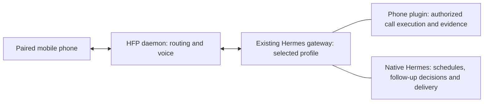

# Hermes Phone

See [compatibility](docs/compatibility.md) and
[validation guidance](docs/validation.md) for tested versions and hardware limitations.

Turn your Hermes Agent into a virtual phone call assistant and office secretary using your paired mobile phone over Bluetooth HFP. Powered by Gemini Live for low-latency, bidirectional conversational voice (with classic STT/TTS fallback), Hermes Phone lets you and your callers interact with Hermes naturally over standard cellular phone calls.

### What you can do
- **Personal assistant:** Call Hermes to manage tasks and use your configured tools with normal approval safeguards. Calendar lookup and booking require an installed, authorized Hermes integration.
- **Receptionist routes:** Admit known or guest callers with isolated memory and explicitly permitted tools. Message delivery and appointment booking require caller-aware integrations; a built-in message-taking tool and owner inbox remain planned.
- **Voice and continuity:** Gemini Live supports conversation and interruption. Caller notes follow the route memory policy; retained dialogue requires continuity or transcript configuration. Authorized background work can continue after hangup and report through configured Telegram delivery.

**Start with [Installation](docs/install.md).** It covers Bluetooth pairing, the Hermes plugin, credentials, your first caller route and startup checks.

Use [Configuration and operations](docs/phone-routing.md) for caller profiles, voice and approvals, and [Maintenance](docs/maintenance.md) for updates, backups and manual removal.

Use the single [routing example](setup/phone.example.yaml) for admin access and optional known-caller/guest routes. The [environment example](setup/hfp-mcp.env.example) keeps optional settings commented out with short explanations; enable only those you need.

For rehearsal and video demonstrations, use the [manual feature checklist](docs/manual-feature-checklist.md) or its [browser version](docs/manual-feature-checklist.html) to record results and follow the suggested demo sequence.

## What gets installed

There are two running components and one plugin source folder:

| Component | Location in this repository | Responsibility |
| --- | --- | --- |
| HFP daemon | `src/hfp_mcp/` | Owns Bluetooth, call routing, audio and the Gemini Live/classic voice backends |
| Hermes phone plugin | `hermes_phone_plugin/` | Integrates phone execution, evidence and caller permissions with native Hermes scheduling, decisions and delivery |
| Installers and examples | `setup/` | Installs the daemon and plugin into their respective Python environments |

`hermes_phone_plugin/` is the **only Hermes plugin to install**. The installer copies it to `<Hermes home>/plugins/hfp-phone/`; its implementation is in the installed `hfp_mcp.hermes_bridge` module. No separate Hermes phone platform or awareness plugin is needed.



## Calls and profiles

- Map your number to your personal profile with admin permissions and normal Hermes approvals.
- Map known callers to profiles with explicitly allowed caller-aware tools.
- Configure a guest default if you want unknown callers answered; otherwise they are declined.
- Automatically save dated caller facts, decisions, and commitments after hangup, with duplicate protection and a visible save result. Keep enabled transcripts for detailed recall.
- Choose `gemini_live` for native voice or `classic` for the profile's STT/TTS providers. Classic can also be an explicit Gemini startup fallback.

Profiles are optional: one personal profile is enough to start. The installer does not create profiles. Routing, permissions, auto-answer and voice selection live in one `phone` YAML section. See [Configuration and operations](docs/phone-routing.md) for additional profiles, caller memory, approvals and integration development.

## Toolsets and capabilities

Hermes Phone cleanly separates concerns across four layers:

### 1. Owner Phone Controls (`hfp_phone` toolset)
Available in your Hermes owner chat channels (e.g. Telegram, Discord, CLI) to control telephone operations:
- `hfp_phone_start_call`: With a purpose, create an immediate native Hermes phone workflow. Acceptance confirms scheduling, not completed conversation. Purpose-free use remains raw manual call control.
- `hfp_phone_caller_read` / `hfp_phone_caller_update`: Read or replace a number's saved notes from owner chat, using the same routed memory as phone calls. Read notes first and supply the returned revision as `expected_revision` when replacing them. For remembered facts and call summaries, use notes first; consult transcripts when notes are insufficient or exact dialogue is requested.
- `hfp_phone_status`: Inspect live call/routing state and profile-scoped requests, attempts, schedules, and decisions.
- `hfp_phone_schedule_call` / `hfp_phone_reschedule_callback`: Create or move a native Hermes call job using the callback ID, revision and stable change request ID. Hermes owns bounded follow-up; status retains decisions and schedules, with gateway notices for exhaustion, expiry or outcomes requiring guidance. See [the workflow guide](docs/hermes-call-workflows.md).
- `hfp_phone_schedule_reminder`: Deliver reminders requested during calls by gateway notification, callback, or both. Set `phone.reminders.default_delivery` in the existing YAML; Hermes selects its configured default gateway destination automatically. Explicit delivery requests override the default. Set `phone.callbacks.retry_delays_minutes: [10, 30, 60]` for four total missed-call attempts; `[]` disables retries. Callbacks preserve the current purpose, support recipient-requested times, and keep receipts in diagnostics. See [reminder configuration](docs/phone-routing.md).
- `hfp_phone_cancel_callback`: Cancel future attempts of a request; ending an already admitted call requires a separate hangup.
- `hfp_phone_owner_lookup`: Read permitted notes, call metadata or retained transcript excerpts with filters and continuation cursors. Admin callers can also use Gemini's `owner_call_lookup`.
- `hfp_phone_transcripts`: List past phone calls or read detailed transcripts when full transcript retention is enabled.
- `hfp_phone_approval`: Explicitly approve (`once`) or deny (`deny`) pending tool execution requests prompted by in-call tasks.

New outgoing destinations do not need a number route. With one configured Hermes
endpoint they receive Gemini conversation and per-number notes automatically;
incoming access and private tool permissions still require their own configured
route. Existing number routes retain their permissions. See
[outgoing calls](docs/phone-routing.md#outgoing-calls-with-a-purpose) for details.
Purpose-bearing calls require the recipient's resolved profile to match the
originating Hermes gateway's profile; lookup grants do not authorize calls across
profiles.

### 2. Caller Context & Memory Tools (`hfp_caller` toolset)
Provided to Hermes during a call to interact with caller-specific data without leaking cross-caller information:
- `hfp_caller_read`: Read persistent notes and facts saved specifically for this caller's phone number.
- `hfp_caller_update`: Save or update persistent notes for this caller (e.g. preferences, agreed details).
- `hfp_caller_recall`: Search and retrieve retained spoken dialogue from earlier calls with this caller.

### 3. Real-Time Spoken Conversation (Gemini Live)
During an active call, Gemini Live streams audio bidirectionally over the 8 kHz SCO Bluetooth link and coordinates with Hermes:
- **Delegated Action (`ask_hermes`):** Real-world actions (calendar lookups, meeting bookings, smart home triggers, reminders) are delegated to Hermes through its native Runs API. Gemini never executes arbitrary tools directly or approves its own actions.
- **Task Coordination (`hermes_task`):** Informs the caller of task progress and allows steering or cancellation. For substantial tasks, Gemini can designate the task to continue after hangup (`continue_after_call: true`), delivering completion results directly to the owner via native Telegram.
- **Conversation Continuity (`phone_session` & `phone_recall`):** Resumes dialogue across calls, provides confirmed voice-reset and history-deletion controls, and preserves conversational context.

### 4. Administrative CLI (`hfp-mcp`)
Run on the Linux host to manage routing, health, and phone enrollment:
- `hfp-mcp doctor`: Verify BlueZ health, credentials, profile connectivity, and voice backends.
- `hfp-mcp route validate` / `explain <number>`: Test phone number normalization and rule matching.
- `hfp-mcp caller inspect` / `forget`: Review or clear stored notes for a given caller.
- `hfp-mcp transcript list` / `show`: View or export retained call transcripts.
- `hfp-mcp enroll`: Open a time-bounded Bluetooth pairing window to connect a new handset.
- `hfp-mcp-server --transport stdio`: Stdio proxy to the running daemon for local MCP clients.

Calendar, booking, and custom business workflows are supplied by standard Hermes skills and integrations. Restricted callers only have access to tools that enforce caller ownership; see the [registration contract](docs/phone-routing.md#integrations).

## Development

See [TODO](TODO.md) and the [implementation backlog](docs/implementation-backlog.yaml)
for implemented groundwork, remaining reliability/office features, and separate
automated, deployment, and live acceptance evidence.

See [Contributing](CONTRIBUTING.md) for environment creation without changing
Bluetooth services. Once the environment exists:

```bash
.venv/bin/python -m pip install -e '.[daemon,dev,gemini-live]' -c setup/test-constraints.txt
.venv/bin/python -m pytest -q
```

The suite covers Bluetooth transport, routing, caller isolation, Gemini integration, cancellation, permissions and installation. Telephone audio and provider quality require the [hardware checks](docs/phone-routing.md#hardware-acceptance).

## Security and license

Caller ID selects permissions but does not authenticate a person. Keep normal
Hermes approvals enabled for admin callers. Voice is processed by your configured
providers; transcript storage and conversation continuity are separate settings.
Read [Security and data handling](SECURITY.md) before configuring callers.

### License, reuse and credit

Hermes Phone is open source under the [MIT license](LICENSE). You can use, modify,
fork and include it in your own projects, including commercial products. Keep the
copyright and permission notice from `LICENSE` with copies or substantial portions
of this software. Dependencies retain their own licenses.

If you build something with Hermes Phone, a mention in your README, acknowledgements
or list of open-source dependencies would be appreciated. For example:

> Uses [Hermes Phone](https://github.com/virusz4274/hermes-phone-hfp)
> by virusz4274 and contributors, licensed under MIT.

This acknowledgement is optional and does not replace the required license notice.

Bug fixes, new integrations, documentation improvements and compatibility reports
are welcome. Please consider contributing improvements back so everyone can benefit;
see [Contributing](CONTRIBUTING.md) to get started. MIT permits private modifications
and does not require publishing changes or submitting pull requests.
