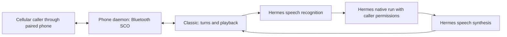

# Expanding classic voice through Hermes

Analysis date: 2026-10-27. Status: proposed design; runtime behavior has not been
changed or deployed by this document.

The [implementation plan](classic-voice-integration-plan.md) defines the work
packages, dependencies, native admission contract and acceptance gates.

## Objective

Expand the existing `classic` phone backend so a headless Hermes installation
owns speech providers, credentials, voice selection and the conversational model.
The phone integration supplies Bluetooth audio, call control, caller permissions
and continuity. Users should configure their speech services in Hermes rather
than configure a second provider stack in the phone daemon.

This is an expansion of classic voice. Keep `gemini_live` available as an
independent option and preserve existing route defaults during implementation.
Desktop plugins and a desktop microphone are not required for this VM use case.

## What the Gemini Flash example means

The [Hermes voice-chat-model documentation][voice-model] configures
`auxiliary.voice_chat`: the model that processes a transcribed spoken request and
uses the agent's tools. The example selects a Gemini Flash text model through
OpenRouter. It does not select Gemini Live or provide speech recognition and
speech synthesis with that single setting.

Classic voice has three separately configured services:

| Stage | Hermes setting | Responsibility |
| --- | --- | --- |
| Speech recognition | `stt` | Caller audio to text |
| Conversational agent | `auxiliary.voice_chat`, when the request is admitted as a voice turn | Reasoning, tools and a text reply |
| Speech synthesis | `tts` | Reply text to spoken audio |

A caller could therefore use a Hermes-supported STT service, a Gemini Flash
agent model and a different TTS voice. Gemini TTS is also distinct from Gemini
Live. Choose available models through Hermes's provider configuration; the model
slug printed in a documentation example is not a permanent availability promise.

This separation also applies to credentials: selecting a subscription-backed
agent does not establish access to either speech service. Hermes resolves each
configured stage's authentication and fallback behavior.

## Evidence and scope

The analysis inspected phone revision
`96bdf10b9145dba94ed3bbd687cd9c3de733ac7d` on `development` and the local Hermes
source checkout at `085f562af53a6fedadac3681e2c498fc71316132`. The inspected Hermes
tracked working tree was clean. These are source observations, not evidence that
the deployed VM runs those revisions or that live providers have passed checks.
The older tested revisions in [compatibility.md](compatibility.md) retain their
separate meaning.

| Source | Observation |
| --- | --- |
| [speech.py](../src/hfp_mcp/speech.py) | Calls Hermes `transcribe_audio` and `text_to_speech_tool`; converts returned speech files to phone PCM using ffmpeg |
| [voice_backends.py](../src/hfp_mcp/voice_backends.py) | Classic owns capture, turn detection, sentence buffering and playback |
| [phone_controller.py](../src/hfp_mcp/phone_controller.py) | `events()` has different execution paths with and without continuity |
| [phone_tasks.py](../src/hfp_mcp/phone_tasks.py) | The gateway task registry admits native runs and owns their event consumer |
| [hermes_bridge.py](../src/hfp_mcp/hermes_bridge.py) | Exposes authenticated phone speech adapters inside Hermes |
| [hermes_compat.py](../src/hfp_mcp/hermes_compat.py) | Speech readiness checks imports and ffmpeg, not provider access |
| Hermes [`agent/voice_turn_route.py`][route-source] | A marked voice turn temporarily uses `auxiliary.voice_chat`, then restores the session route |
| Hermes [`gateway/session_surface.py`][surface-source] | Carries validated per-turn voice and interruption metadata through native admission |
| Hermes [`tools/transcription_streaming.py`][stt-source] | Exposes provider-neutral streaming STT sessions and file fallback support |
| Hermes [`tools/tts_streaming.py`][tts-source] | Resolves configured PCM streamers and provides shared sentence processing |
| Hermes [`tools/voice_live.py`][live-source] | Built-in GPT-Live relies on the Desktop renderer for media and delegation |

The [voice-mode page][voice-docs] spans CLI/TUI, messaging and Desktop. The
underlying speech services can run on the VM. Its GPT-Live section describes a
Desktop-specific conversation path; that setting is not a generic headless
Bluetooth voice service.

## Current classic behavior and gaps

The existing path already avoids a daemon-side Gemini connection:



The transport is CVSD, 8 kHz mono signed 16-bit PCM. Classic segments speech
locally, sends a complete utterance to `/v1/hfp/speech/transcribe`, obtains Hermes
output, then calls `/v1/hfp/speech/synthesize`. Each synthesized sentence is fully
generated and decoded before the daemon plays it.

The following gaps matter before claiming parity with Hermes voice mode:

1. **Voice model selection is not connected.** Both `HermesAPI.events()` and
   `GatewayTasks.launch()` submit text runs without an explicit voice-turn
   marker. Merely configuring `auxiliary.voice_chat` is insufficient evidence
   that phone calls use it. The inspected Runs API path does not visibly carry
   that marker into canonical admission. Adding an unconsumed JSON field would
   not solve this.
2. **Continuity does not forward reply deltas.** With continuity off, classic can
   receive `message.delta` events through the direct run path. With continuity
   on, `PhoneController.events()` polls the task registry and yields the terminal
   result. `GatewayTasks.drain_events()` consumes and discards the native
   stream. Streaming TTS alone cannot remove this wait. Its single-consumer
   comment is stale for the inspected Hermes revision: native `_RunStream`
   supports multiple subscribers, sequence cursors and bounded replay.
3. **Speech is buffered.** The phone adapters use file transcription and complete
   synthesized files. Hermes's streaming modules exist, but classic does not
   invoke them today.
4. **Some presentation logic is duplicated.** Classic has its own sentence regex,
   fixed speech threshold and 0.7-second end-of-speech delay. It does not adopt
   all Hermes voice settings, hallucination filtering or reasoning-text cleanup.
5. **Lifecycle parity needs work.** `ClassicVoice` lacks the `notify` and `refresh`
   methods implemented by `GeminiVoice`; conversation code calls or waits for
   those operations. Background announcements and conversation resets therefore
   need explicit classic behavior.
6. **Readiness is limited.** Importable speech functions and ffmpeg do not verify
   credentials, provider support, model choice or successful audio generation.

## Proposed ownership

| Component | Owns |
| --- | --- |
| Phone daemon | HFP/SCO connection, audio leases, playback pacing, resampling boundaries, call lifetime and route selection |
| Hermes phone bridge | Authenticated audio adaptation, profile scope, bounded streaming transport and caller/task authorization |
| Hermes core | STT/TTS provider lookup, credentials, model routing, tools, approvals, native execution and session storage |
| Expanded classic backend | Coordination between telephone audio and those Hermes interfaces |

Keep all speech provider imports inside the Hermes environment. The Bluetooth
daemon should not need provider SDKs or speech credentials. Encapsulate Hermes
internal imports in compatibility adapters and check their contracts explicitly;
an upstream refactor can still require an adapter update. This reduces duplicated
provider maintenance rather than promising zero maintenance.

## Implementation sequence

### 1. Carry native voice-turn intent

First establish a supported Hermes admission contract for a phone voice turn.
Trace it through Runs API parsing, idempotency, durable admission, execution and
worker recovery. The existing canonical `voice_turn` mechanism is the intended
integration point; determine whether an upstream Hermes change is required.

Apply it to direct classic turns and continuity-backed classic tasks. Persist
the intent with the task so retries and restart recovery preserve it. Do not
mark Gemini Live delegated jobs or unrelated callback/background work merely
because they originated during a call. Define which recovered or continued work
should retain the original voice route before extending that behavior.

Hermes should resolve `auxiliary.voice_chat` within the routed profile, retain
its normal tool restrictions and approvals, and restore the main model after the
turn. Verify inherited-model behavior, provider failures, smaller context windows
and reasoning settings through Hermes's own routing policy. Do not mutate the
session model or switch to another caller's profile to obtain a faster reply.

### 2. Forward text from the existing native task

Expose an authorized observation path for the active call's existing task/run.
Reuse native SSE sequence cursors and replay rather than adding a phone event
journal. Multiple native subscribers are supported in the inspected revision;
phone task ownership and authorization still need to be checked before relaying
events. Define reconnect behavior, expiry and duplicate suppression, and verify
the native stream contract against each supported Hermes revision.

The call must observe the same task/run whose state drives approvals and final
results. If incremental output is unavailable, retain the result-based response
and report that capability accurately. Reconnecting must never resubmit work or
replay already spoken sentences. Keep partial output separate from confirmed
task completion.

### 3. Stream Hermes speech output

Use Hermes's `resolve_streaming_provider()` and shared text processing inside
the phone bridge, without opening a host speaker. Feed authorized assistant text
into a bounded PCM stream and adapt it to the current SCO lease.

Read the actual PCM format when output begins; Hermes streamers can update their
sample rate after the first chunk. Convert statefully to 8 kHz mono s16le,
preserve sample boundaries across chunks and apply backpressure. Do not assume
every provider returns 24 kHz or independently resample each network packet.

When the chosen provider has no usable PCM streamer, retain sentence-level file
synthesis using that provider. Follow Hermes's explicit provider/fallback policy;
do not silently choose another voice just because streaming is available.

Reuse Hermes text scrubbing so reasoning tags, Markdown, tool payloads and unsafe
formatting are not read aloud. Remove the current silent 2,000-character slicing
as a loss mechanism: split at supported limits and explicitly handle oversized
or interrupted output.

Prefer an authenticated phone-bridge streaming route over coupling a headless
call to Desktop's dashboard sockets. The dashboard has useful reference
implementations (`/api/audio/transcribe-stream` and `/api/audio/speak-stream`),
but uses its own authentication and session protocols. Exact new phone endpoint
names and wire schemas remain implementation work, not existing APIs.

### 4. Stream Hermes speech input

Use `open_streaming_session()` under the caller's Hermes profile when its STT
configuration enables streaming. Its normal input contract is 16 kHz mono s16le;
the inspected session also offers `set_input_rate()`. Verify that contract for
the selected built-in or plugin session before using it with 8 kHz SCO input.

Keep a bounded utterance recording for file fallback. Finalize once at a confirmed
speech boundary; partial transcripts must not execute tools. If the stream cannot
open or fails, transcribe the buffered utterance through the same Hermes STT
configuration and admit at most one final request. Upsampling changes format,
not the narrowband information captured by the phone.

### 5. Finish interruption and conversation behavior

Use confirmed speech activity, rather than a single noisy frame, for interruption.
Keep telephone-specific sensitivity configurable and test echo and line noise.
Clear queued playback and invalidate the interrupted output generation promptly;
late STT, text and TTS results must not enter the next turn or call.

Separate stopping audible output from cancelling real work. Use native stop or
steer operations under the existing caller policy, and reconcile uncertain
results before another action. Cancelling an asyncio waiter does not prove that
a continuity-backed task stopped. Preserve explicitly authorized continued work
under existing task policy and lifetime limits.

Implement classic `notify`/`refresh` semantics for task announcements, context
changes and session resets. Scope interruption notes and delivery state to the
call/session, rather than using a process-global playback latch across callers.
Record generated text, queued audio, submitted audio and interrupted delivery
separately; never claim the caller heard a complete answer from synthesis alone.

### 6. Expose capability and timing evidence

Extend authenticated readiness with file/streaming STT, file/PCM TTS and native
voice-turn-routing support. Distinguish configured, locally available and
live-verified states. Report the effective voice model/provider when known and
when Hermes used its main-model fallback. Keep keys and private profile details
out of caller-facing status.

Measure speech end, final transcript, run admission, first assistant text, first
TTS chunk and first submitted phone audio. Validate improvements against the
current classic baseline on the same host and providers; do not promise a latency
target without measurements.

## Configuration direction

The existing phone route selector remains sufficient:

```yaml
# Merge into the existing number route; endpoint and policy stay required.
voice: classic
```

Use Hermes configuration for `stt`, `tts` and `auxiliary.voice_chat`. Users who
want Gemini Flash select their configured Gemini/OpenRouter provider and an
available Flash agent model in Hermes's auxiliary-model settings. They still
select STT and TTS independently. Inherit the main agent when no separate voice
model is wanted.

Today, `voice: classic` already selects the Hermes-backed file speech path.
Honoring `auxiliary.voice_chat` for phone requests and enabling streamed phone
speech are proposed changes. Setting `stt.streaming: true` alone does not add
streaming to the existing phone adapter. No new phone configuration keys are
introduced by this document.

## Acceptance and rollout

| Check | Required evidence |
| --- | --- |
| Model selection | Both continuity modes use the configured voice model for eligible classic turns, preserve tools/approvals and restore the main route afterward |
| Profile isolation | Two profiles with different speech settings cannot share credentials, audio, interruption notes or task output |
| Headless independence | Classic starts without Desktop, a host microphone/speaker, a daemon Gemini SDK or a Gemini Live key; only the selected Hermes providers' requirements apply |
| Text streaming | A delayed native run speaks a complete first sentence before its terminal result, through an authorized observer of the existing run |
| Replay safety | Reconnects and restart recovery do not duplicate actions, transcripts or previously submitted speech |
| Audio correctness | Format changes, odd chunk boundaries, backpressure and resampling produce valid bounded 8 kHz mono PCM |
| Speech fallbacks | Nonstreaming providers remain usable; a failed STT stream produces at most one admitted final request |
| Interruption | Noise does not spuriously cancel work; confirmed speech stops old playback; native task cancellation/continuation is accounted for separately |
| Spoken content | Fragmented reasoning tags, long replies, tool errors and approval prompts are handled without leaking internals or truncating silently |
| Lifecycle | Hangup, notification, context refresh, reconnect and a subsequent caller cannot reuse stale output or authority |
| Hardware/provider acceptance | Incoming and outgoing calls on the VM, retained continuity, cold starts and noisy/quiet speech have dated results |

Extend existing voice-backend, controller, phone-task, speech-adapter and isolated
Hermes compatibility tests. Use delayed fake providers for meaningful streaming
and cancellation checks; keep real calls/provider validation as separate evidence.

Ship in stages with file-based classic preserved as a fallback. Run the isolated
Hermes checks against the exact proposed Hermes revision before deployment.
Coordinate any required daemon/plugin/Hermes upgrade and then perform the
[hardware acceptance checks](phone-routing.md#hardware-acceptance). No deployment,
provider request, phone call or default switch was performed for this analysis.

## Next implementation task

Start with native voice-turn admission and tests for both continuity modes.
Resolve the Hermes API gap before adding audio streaming: a faster speech path
would otherwise still use the wrong agent-model selection. Then extend the
authorized native task event path and Hermes-backed output streaming together, followed
by streaming STT and the lifecycle checks above.

[voice-docs]: https://hermes-agent.nousresearch.com/docs/user-guide/features/voice-mode
[voice-model]: https://hermes-agent.nousresearch.com/docs/user-guide/features/voice-mode#voice-chat-model
[route-source]: https://github.com/NousResearch/hermes-agent/blob/085f562af53a6fedadac3681e2c498fc71316132/agent/voice_turn_route.py
[surface-source]: https://github.com/NousResearch/hermes-agent/blob/085f562af53a6fedadac3681e2c498fc71316132/gateway/session_surface.py
[stt-source]: https://github.com/NousResearch/hermes-agent/blob/085f562af53a6fedadac3681e2c498fc71316132/tools/transcription_streaming.py
[tts-source]: https://github.com/NousResearch/hermes-agent/blob/085f562af53a6fedadac3681e2c498fc71316132/tools/tts_streaming.py
[live-source]: https://github.com/NousResearch/hermes-agent/blob/085f562af53a6fedadac3681e2c498fc71316132/tools/voice_live.py
