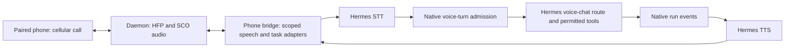

# Classic voice integration with native Hermes

Prepared: 2026-10-27. Status: implementation plan; all work packages pending.
Branch: `development`. Source baseline and supporting analysis are recorded in
[classic-voice-expansion.md](classic-voice-expansion.md).

## Intended result

An existing `voice: classic` route on the VM accepts Bluetooth phone speech,
uses the selected Hermes profile's STT, runs eligible spoken turns through
Hermes's `auxiliary.voice_chat` routing, and speaks through Hermes's TTS.
Continuity, caller restrictions, approvals and native tasks remain effective.
Stream text and speech when the configured providers support it; retain the
file speech path when they do not.

The Gemini Flash example in the Hermes documentation configures the agent
model between STT and TTS. It does not imply Gemini Live audio. Model selection
and credentials belong to Hermes, including its native fallback rules. The phone
daemon does not create another LLM client or maintain its own provider catalog.

The plan is complete only when implementation and automated acceptance have
evidence. VM deployment and real-call acceptance have separate completion states.
This planning change does not install plugins, edit private configuration,
restart services or make calls.

## Architecture and decisions

| Concern | Decision |
| --- | --- |
| Native agent route | Carry a validated per-turn voice marker into canonical Hermes admission; use existing route binding/restoration |
| Scope of the marker | Classic spoken foreground turns only; Gemini Live delegations and unrelated jobs keep their current routing |
| Task execution | Observe the admitted native run; never start a second agent to obtain a spoken reply |
| Continuity | Keep the existing caller conversation, task registry and native session history |
| Incremental output | Reuse native SSE sequences, cursors and bounded replay through a task-authorized bridge |
| Speech providers | Resolve and invoke Hermes providers inside the routed Hermes profile |
| Audio | SCO remains 8 kHz mono s16le; adapt provider formats at explicit boundaries |
| Unsupported capabilities | Preserve existing file classic behavior with a visible capability limitation; do not claim voice-model routing when it is absent |
| Defaults | Preserve `classic`/`gemini_live` route names and existing defaults; no automatic migration of active routes |
| Storage | Add versioned task metadata to existing records; avoid a second transcript store, scheduler or native-event journal |

## Work packages and dependencies

| ID | Deliverable | Depends on | Status |
| --- | --- | --- | --- |
| CV-00 | Native contract and compatibility checks | — | Pending |
| CV-01 | Voice-model routing in both classic execution paths | CV-00 | Pending |
| CV-02 | Authorized native text streaming with continuity | CV-01 | Pending |
| CV-03 | Shared spoken-text handling and streamed Hermes TTS | CV-02 | Pending |
| CV-04 | Streaming Hermes STT with file fallback | CV-00, CV-01 | Pending |
| CV-05 | Interruption, notifications and conversation lifecycle | CV-02, CV-03, CV-04 | Pending |
| CV-06 | Readiness, diagnostics and configuration documentation | CV-01–CV-05 | Pending |
| CV-07 | Integrated automated acceptance | CV-00–CV-06 | Pending |
| CV-08 | VM rollout and real-call evidence | CV-07 | Pending; deployment/live |

CV-01 is the first usable milestone: the correct Hermes voice model with the
existing file STT/TTS path. Streaming work must not delay or obscure that routing
milestone. CV-03 and CV-04 can proceed independently once their dependencies pass.

## CV-00: Native contract and compatibility

Inspect the target Hermes revision before editing it. The inspected baseline
contains canonical `voice_turn` handling, but the Runs API does not visibly
forward it through API admission. Plan a small upstream extension rather than
patching `AIAgent` private state from the phone plugin.

Proposed native contract, subject to the upstream naming conventions:

- `POST /v1/runs` accepts optional strictly boolean `voice_turn` and `interrupted`
  fields, false when omitted. Invalid types fail before admission.
- Canonical admission stores them with the existing per-turn surface metadata.
  Do not label classic input `surface: voice-live`; that surface describes a
  separate live-model delegation contract.
- Include the new intent in retry identity and durable recovery. An exact retry
  returns the same run; a reused key with changed intent conflicts. Preserve
  existing clients' omitted-field replay behavior.
- In-process and managed-worker execution reach the same existing voice route
  and restore the primary route on every exit. Include selected/live-session
  admission paths if the native Runs API can dispatch to them.
- Advertise support in native capabilities, distinguishing voice intent and
  interruption metadata if the target supports only one. Capability names are
  proposed, not claims about current Hermes.

Keep capability detection and Hermes imports in `hermes_compat.py`. Validate the
actual admission/execution behavior with the real target Hermes in a disposable
home; a module import or accepted-but-ignored JSON field is insufficient.

**Acceptance CV-00-A:** strict validation, same-key retry/conflict behavior,
durable recovery, route restoration and capability advertising pass upstream
tests. Record whether support is released, pinned to an upstream revision, or
still awaiting an upstream change. Do not silently emulate the missing feature.

## CV-01: Wire classic turns into native routing

Change `voice_backends.py`, `phone_controller.py`, `hermes_api.py`,
`hermes_bridge.py` and `phone_tasks.py` as needed:

1. Give the internal turn submission a typed origin: classic speech or ordinary
   task. Derive it from the authenticated controller/call context, never from
   spoken text or a model-selected tool argument.
2. Forward native voice intent on direct, continuity-disabled runs.
3. Persist versioned origin and interruption metadata with continuity tasks,
   validate it against the admitted binding, and forward it in `GatewayTasks.launch()`.
   Existing records with no origin retain ordinary-task semantics. Keep old
   request fingerprints replayable; do not rewrite accepted task identity.
4. Resolve the effective voice model using the routed Hermes profile, preserving
   tools, approvals and the session's main model. Observe native runtime metadata
   where available; do not guess the effective route from configuration alone.
5. A classic spoken turn already admitted as a voice turn retains that identity
   through recovery. New scheduled decisions, memory closeout, Gemini Live jobs
   and owner-chat tasks do not inherit it. Continuing an already authorized run
   after hangup preserves its original admission; this adds no new continuation grant.

On an older Hermes without voice-intent support, existing file classic may still
run on its main model. Report the missing voice-route capability explicitly.
Do not substitute manual model overrides or change the profile default to hide
the missing contract. Full integration acceptance requires CV-00 support.

**Acceptance CV-01-A:** continuity on/off each select a distinct configured voice
model; inherited model and native fallback work; typed/Gemini/background requests
remain unaffected; guest restrictions, approval denial, cancellation and main-route
restoration pass. Recovery preserves routing without admitting duplicate work.

## CV-02: Stream the existing native run

Add a phone-bridge observation route for a task's native events. Its proposed
shape is `GET /v1/hfp/tasks/{task_id}/events`; finalize its schema with the code.
Require bridge authentication and a live binding, then resolve conversation,
task, run and profile ownership server-side. Recheck authority during the stream
and close it on hangup, revocation, expiry or a conversation-generation change.

Native `_RunStream` in the inspected Hermes supports fan-out, `Last-Event-ID`
and `replay.truncated`. The single-consumer comment in `phone_tasks.py` is stale.
Use these native contracts rather than building durable event replay in the
phone plugin. Keep the registry's existing status/reconciliation responsibility;
an observation disconnect must not itself stop or resubmit work.

Update the continuity branch of `PhoneController.events()` to relay eligible
assistant text and control events for the same task. Preserve native sequence
identity and reject duplicate events within the active observation. Carry the
last consumed cursor on reconnect. Handle `message.interim`/`already_streamed`
without duplicating `message.delta`; never send reasoning or raw tool events to TTS.
Deduplicate approval announcements by request identity.

When replay is truncated or the stream disappears after a gateway restart,
reconcile through native task status. Do not regenerate the task or replay the
whole terminal answer over audio already submitted. Deliver only a verifiably
unspoken suffix, or announce that streaming was interrupted and offer an explicit
replay. After process restart, uncertain playback is not automatically resumed.

**Acceptance CV-02-A:** delayed runs yield speakable text before completion;
continuity stays on the same run/session; reconnect, duplicate events, backlog
truncation, multiple observers and authorization loss cannot replay actions,
cross callers or duplicate submitted speech.

## CV-03: Shared text handling and Hermes TTS

Move speech adaptation into focused Hermes-side modules rather than expanding
`hermes_bridge.py` with provider implementations. Use the existing Hermes
sentence chunker and scrubbing interfaces via compatibility adapters.

Define an authenticated TTS stream with an initial actual-format frame, binary
PCM chunks, a terminal result and explicit error/cancel semantics. Bind it to
the physical call, conversation generation and reply identifier. No provider
key or local output-file path crosses into the daemon.

Resolve the configured Hermes PCM streamer; if unavailable, use the configured
file synthesis path sentence by sentence. Honor Hermes's explicit fallback
policy and voice settings. Use bounded worker queues and cancellation so a slow
or synchronous provider cannot block the gateway event loop or keep filling audio
after hangup. Verify late failures and upstream cleanup separately from local
playback cancellation.

Use the format advertised after the first provider chunk, carry partial samples
and resampler state between chunks, and convert to phone PCM. Pace output using
the existing SCO ownership rules. Split long text at supported limits rather
than silently slicing it at 2,000 characters. Preserve filtering across split
reasoning tags and fragmented Markdown.

**Acceptance CV-03-A:** delayed streamers produce phone audio before synthesis
ends; nonstreaming providers retain their selected voice; rate changes, fragmented
frames, long replies, reasoning tags, full queues, provider errors and mid-sentence
cancel have bounded and observable outcomes.

## CV-04: Hermes streaming STT

Add a scoped speech-input session adapter using Hermes
`open_streaming_session()`. Follow `stt.streaming`; fall back to the existing
Hermes file transcription path when it is disabled or unsupported. Explicitly
verify 8 kHz input conversion or the supported `set_input_rate()` contract.

Retain only bounded current-utterance audio for fallback. Track a unique utterance
ID and states: capturing, finalizing, transcribed, admitted or cancelled. Submit
one final transcript through CV-01. Partial transcripts can inform diagnostics
or speech detection but cannot admit tools or agent work.

On a live STT failure, finalize through the fallback once. On cancellation or
hangup, invalidate late results; permitted transcript closeout may retain final
words without executing a new task. Reuse Hermes's no-speech/hallucination handling
where supported. Do not add audio retention by default.

**Acceptance CV-04-A:** streaming-off, unsupported, failed-connect and mid-utterance
failure paths produce at most one task; finalization timeouts, repeated finals,
late finals, silence and hangup cannot create a duplicate or post-call action.

## CV-05: Conversation and interruption lifecycle

Implement `ClassicVoice.notify()` and `refresh()` with explicit outcomes so
conversation code cannot wait forever for unsupported operations. Deduplicate
notifications against text already spoken from the active run. Queue authorized
background results only for the current caller and generation; a closed call
uses existing native delivery rules instead of another audio session.

For barge-in, require confirmed speech activity and invalidate the old reply
generation. Stop and clear audible output immediately; decide native stop/steer
separately under existing task intent and continuation policy. Wait for or
reconcile the native outcome before admitting a conflicting action. Do not treat
async waiter cancellation as proof that a tool was cancelled or undone.

Pass the interruption fact to the next eligible classic admission. Keep it
per-call, not in Hermes's process-global speaker latch. Session reset/compaction
must stop stale playback, refresh the relevant state and announce only confirmed
results. A bare voice stop phrase ends this phone conversation according to an
explicit tested mapping to call hangup; never apply a historical stop phrase.

Before adding tuning keys, reconcile Hermes's existing voice settings with phone
constraints. Reuse compatible settings and add phone-specific overrides only where
required, with documented precedence and strict validation. No provider configuration
is duplicated in phone YAML.

**Acceptance CV-05-A:** noise, talk-over, pending approvals, active tools,
authorized continuation, notifications, reset/compaction, reconnect and a second
caller preserve task identity and cannot receive stale speech or authority.

## CV-06: Readiness and operator experience

Extend `speech_readiness()`, bridge capabilities and phone diagnostics to expose:

- File STT/TTS and streaming STT/PCM TTS support for the selected profile.
- Native voice-turn admission support and requested/effective model information
  when actually observed, including native fallback.
- Explicit configured, locally available and live-verified states.
- Current stage, failure/fallback reason and bounded queue/timeout diagnostics.

Timestamp capture/speech end, final transcription, admission, first assistant
text, first provider audio and first submitted SCO audio. Keep generated, queued,
submitted and interrupted delivery distinct. Metrics must not claim that a
caller heard an answer or that queue drops measure Bluetooth packet loss.

Update README, routing, compatibility, installation and manual acceptance docs.
Show a complete classic route and separate Hermes STT/TTS/auxiliary settings,
including inherited-model and Gemini Flash selection through an available
Hermes provider. Distinguish Gemini text routing, Gemini TTS and Gemini Live.
Document provider-specific credentials without assuming agent subscription
credentials also pay for speech. No dashboard is required for normal operation.

**Acceptance CV-06-A:** operators can identify the chosen backend, route support,
fallback and a failing speech stage without exposing credentials or another
profile's private settings. Every newly documented option exists in code.

## CV-07: Automated verification and completion

Extend the existing suites as behavior changes:

| Tests | Coverage |
| --- | --- |
| `tests/test_hermes_api.py`, `tests/test_hermes_bridge_http.py` | Native intent, scoped observation and audio protocols, auth, retries and disconnects |
| `tests/test_phone_tasks.py` | Persisted origins, fingerprints, stream observation, approvals and recovery |
| `tests/test_voice_backends.py` | Delayed speech/text streaming, formatting, resampling, bounded queues and fallback |
| `tests/test_phone_controller.py`, `tests/test_phone_conversations.py` | Both continuity modes, cancellation, notifications, reset and caller isolation |
| `tests/test_phone_routing.py` | Existing routes/defaults and any justified new tuning validation |
| `scripts/check_hermes.py` and Hermes upstream tests | Real native interface/admission contracts in a disposable home, without external provider calls |

Add focused speech-adapter tests where the existing suites do not cover the new
interfaces. Use delayed, controllable fake providers to prove incremental timing,
single admission and cleanup. Test a headless environment without Desktop, host
audio devices, daemon provider SDKs or Gemini Live credentials.

Run affected suites for each package, then the project suite once integration is
complete. Run the isolated compatibility script with the exact Hermes interpreter
and record the command. Do not present fake-provider tests as live speech evidence.

**Acceptance CV-07-A:** all CV-00–CV-06 checks have passing evidence and relevant
regressions pass. Record command, result, tested phone/Hermes revisions or explicit
working-tree description, and source/test references. A missing native API contract
blocks full integration completion even if file classic continues to function.

## CV-08: Rollout, comparison and rollback

1. Prepare compatible phone daemon/plugin packages and the supported Hermes
   revision. Back up configuration and existing task/conversation stores under
   the repository's maintenance procedure. Keep task metadata additions readable
   when absent and preserve existing records and fingerprints.
2. Complete code review and isolated checks before any service change. Deploy
   only within separately established operational authorization; this plan alone
   is not a service-restart or real-call instruction.
3. Exercise a selected owner route with `voice: classic`; leave other routes
   unchanged. Compare the existing file classic baseline and expanded classic
   on the same VM, handset, speech providers and network conditions.
4. Record incoming/outgoing calls, continuity on/off, inherited/configured voice
   model, streaming and file speech, interruption, approval denial, hangup,
   reconnect, restart recovery and a restricted caller. Include cold/warm timing
   distributions and errors rather than a single best-case latency figure.
5. If audio quality, routing or task correctness regresses, return to the previous
   verified packages/configuration or disable the expanded optional capabilities
   using implemented controls. Reconcile accepted tasks before rollback; never
   replay them to reproduce an answer. Do not restore an old task database over
   work admitted after the backup.

**Acceptance CV-08-A:** dated VM/provider/hardware evidence identifies exact
versions, results and unresolved limits, without private caller data. Deployment
and live checks remain pending until performed, independently of CV-07 completion.

## Progress and handoff

Use the stable CV IDs above in implementation notes and commits. For each work
package, append evidence using these fields:

| Field | Required content |
| --- | --- |
| Status | Pending, in progress, blocked or done |
| Acceptance | Passing/failed/pending checks by CV acceptance ID; detailed scenarios above remain requirements |
| Evidence | Exact command/procedure, result, tested revisions and relevant files |
| Blocker | Concrete missing dependency and what resolves it, when applicable |
| Deployment/live | Separate evidence; never inferred from automated tests |

Start at CV-00. Verify the native contract, implement it upstream if needed,
then complete CV-01 using existing file speech. Continue through the dependency
table. Keep `gemini_live` regression coverage and the current file classic path
throughout. Do not recreate existing scheduling, memory, approval or delivery
services, and do not mark the plan complete merely because a call connected.
